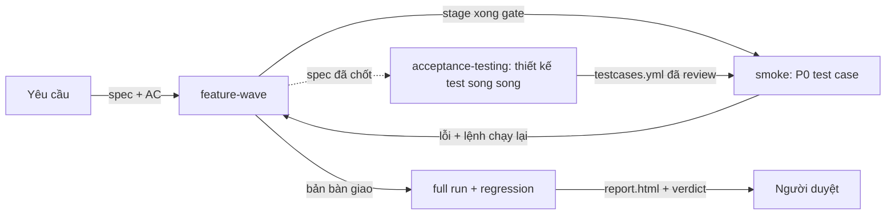

# claude-shipyard

Bộ công cụ cho [Claude Code](https://claude.com/claude-code) để **thi công tính năng bằng đội agent**, **kiểm thử
nghiệm thu trên trình duyệt thật**, và **báo cáo theo chuẩn dễ review**. Chạy trên macOS, Linux/WSL và Windows 10/11.

| Thành phần | Là gì | Gọi bằng |
|---|---|---|
| `skills/feature-wave` | Lead chia việc cho đội agent: triage → nghiên cứu → spec (EARS) → critic → thi công theo stage (builder song song, gate, audit độc lập, smoke) → kiểm tra chạy thật → báo cáo. Trạng thái nằm trên đĩa (`.wave/<slug>/`), sống qua compaction. | `/feature-wave <mô tả>` |
| `skills/acceptance-testing` | Kiểm thử nghiệm thu theo quy trình ISTQB: test basis → test case (`testcases.yml`) → review độc lập → Playwright có ảnh/trace → defect report → confirmation + regression → báo cáo HTML (ISO/IEC/IEEE 29119-3). Chạy song song với thi công hoặc độc lập. | `/acceptance-testing <slug>` |
| `agents/` | 7 vai: `wave-researcher`, `wave-critic`, `wave-auditor`, `wave-builder`, `test-designer`, `test-reviewer`, `test-executor`. | skill tự gọi |
| `rules/CLAUDE.md` | Rule báo cáo "dễ review": câu ngắn, Fact / Assumption / Unknown, diagram ≤ 12 node có nhãn, HTML tương tác chỉ khi đáng công. | tự áp dụng mọi phiên |



## Cài đặt

Cần có: **git**, **Python ≥ 3.8**, **Node.js ≥ 18** (chỉ cần cho test trình duyệt), Claude Code.

### macOS / Linux / WSL
```bash
git clone https://github.com/0xsyncroot/claude-shipyard.git
cd claude-shipyard && ./install.sh
```
macOS nên có thêm `brew install coreutils` (lệnh `gtimeout`). Thiếu thì `install.sh` chỉ cảnh báo.

### Windows 10/11 (Claude Code chạy native, không qua WSL)
1. Cài [Git for Windows](https://git-scm.com/download/win), [Python](https://www.python.org/downloads/) (tick *Add
   python.exe to PATH*) và [Node.js LTS](https://nodejs.org).
2. `git clone https://github.com/0xsyncroot/claude-shipyard.git`. Nếu tải bản ZIP: chuột phải → Properties →
   **Unblock** trước khi giải nén.
3. Bấm đúp **`install.cmd`**.

Mọi kết quả ghi vào `install-log.txt`. Khi gặp lỗi, gửi file này.

### Bộ cài làm gì (cả hai bản)
- Chép 2 skill vào `~/.claude/skills/` và 7 agent vào `~/.claude/agents/`. Bản cũ được chuyển sang
  `~/.claude/backup/shipyard-<thời điểm>/`.
- Tạo venv riêng `~/.claude/skills/acceptance-testing/.venv` chứa PyYAML. Lý do: Python của Homebrew chặn
  `pip install` vào hệ thống (PEP 668), còn `python3 -I` bỏ qua thư viện cài `--user`. `qa.py` tự chạy lại bằng venv
  này, nên mọi lệnh trong tài liệu skill giữ nguyên.
- Ghi rule báo cáo vào `~/.claude/CLAUDE.md`, **giữa hai dòng đánh dấu** `claude-shipyard:rules`. Phần còn lại của
  file giữ nguyên, và luôn có bản `.bak`.
- Bật `CLAUDE_CODE_EXPERIMENTAL_AGENT_TEAMS=1` trong `~/.claude/settings.json` (feature-wave cần để chia team).
- Windows: đặt `CLAUDE_CODE_GIT_BASH_PATH` (vì `bash` trong PATH có thể là WSL) và bật `git core.longpaths`.
- Tự kiểm thử trên một repo tạm: `wave-init.sh`, `wave-cost.py`, `qa.py init/status/report`.

### Kiểm tra, cập nhật, gỡ
| Việc | macOS / Linux | Windows |
|---|---|---|
| Chỉ kiểm tra, không sửa gì | `./install.sh --check` | `doctor.cmd` |
| Cập nhật | `git pull && ./install.sh` | `git pull`, rồi `install.cmd` |
| Không đụng CLAUDE.md / settings | `--no-rules`, `--no-settings` | `-NoRules`, `-NoEnv` |
| Gỡ | xoá `~/.claude/skills/{feature-wave,acceptance-testing}`, các file `agents/wave-*.md` và `agents/test-*.md`, cùng khối giữa hai dòng `claude-shipyard:rules` trong `CLAUDE.md` | như bên trái, dưới `%USERPROFILE%\.claude` |

Test trình duyệt cần Playwright. Chạy **một lần cho mỗi dự án**, sau `qa.py init`:
`bash ~/.claude/skills/acceptance-testing/scripts/pw-setup.sh`. Script này cài Playwright vào `<repo>/.qa/node_modules`,
không đụng workspace của dự án.

## Khác biệt giữa các hệ điều hành
Các skill viết bằng lệnh bash. Script tự xử lý chỗ khác nhau, ví dụ cổng đang nghe: `ss` → `lsof` → `netstat`.
Phần Claude cần biết nằm trong skill:
- macOS: ghi chú ngay trong `SKILL.md`.
- Windows: `skills/*/windows.md`, gồm `taskkill //T`, MSYS path conversion, `python3` giả của Microsoft Store,
  và cách PowerShell 5.1 nuốt dấu `"`.

## Đã kiểm thử
| Môi trường | Kết quả |
|---|---|
| Linux (Ubuntu, bash 5, Python 3.12) | cài, cài lại, `--check`: đạt |
| bash 3.2.57 (bản của macOS), không có PyYAML, chỉ có `lsof` | cài + selftest đạt; `qa.py` tự chạy lại bằng venv |
| Python 3.9 (bản của Xcode Command Line Tools) | cài đạt; `lint` + `report` trên bộ 68 test case thật: kết quả giống hệt Python 3.12 |
| Windows 11, PowerShell 5.1 (cùng bản Windows 10), Git Bash, Python bản Store | cài + `doctor` + selftest đạt |

Chưa chạy trên máy Mac thật. Hai bài giả lập ở trên phủ hai điểm Mac hay vỡ nhất: bash 3.2 và Python 3.9.

## Cho người bảo trì
Skill được viết và dùng hằng ngày trong `~/.claude` của máy chính. Để đồng bộ lên repo:
```bash
python3 tools/export.py      # chép skills/agents/rules, lọc tham chiếu riêng tư
git diff                     # đọc lại trước khi push
```
`export.py` dừng với lỗi nếu còn từ nào trong `~/.claude/tools/shipyard-denylist.txt`. Danh sách này cố ý đặt ngoài
repo.

## License
MIT. Xem [LICENSE](LICENSE).
